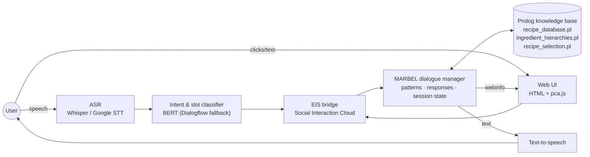

# Cooker AI

**A speech-based conversational agent that recommends recipes from a database of ~1,000 dishes. It understands what you want ("something Italian, no chicken, under 30 minutes"), narrows the results turn by turn, and shows each recommendation visually.**

<!-- Screenshots: replace the placeholders below -->
| Conversation | Filtering | Recipe details |
|---|---|---|
|  |  |  |

## Features

- **Spoken and typed interaction:** speech input via ASR (Whisper / Google STT) and spoken replies via text-to-speech, plus a browser UI.
- **Intent & slot understanding:** a custom BERT-based intent and slot (BIO-tagging) classifier, with Dialogflow as a stable fallback for live demos.
- **Multi-turn filtering:** add and remove constraints on ingredients, cuisine, meal type, dietary restrictions and cooking time, while the agent remembers earlier constraints.
- **Exclusions:** "no chicken", "without garlic", multiple exclusions at once, removing a single exclusion or clearing all of them.
- **Visual recipe cards:** the recipe image, preparation time, servings and cuisine are pushed live to the web UI as the conversation progresses.
- **Explainable dialogue management:** explicit MARBEL conversation patterns plus Prolog reasoning over the recipe database. Every step is visible in logs.

## Architecture



## How to run

**Prerequisites:** Conda, Redis, Eclipse with the MARBEL plugin, and a microphone and speakers.

1. Create and activate the environment:
   ```sh
   conda env create -f environment.yaml
   conda activate PCA26
   ```
2. Install the Social Interaction Cloud framework:
   ```sh
   cd social-interaction-cloud
   pip install -e .
   cd ..
   ```
3. Start Redis and check that it responds:
   ```sh
   redis-server        # or: brew services start redis
   redis-cli ping      # -> PONG
   ```
4. Start the NLU/ASR services and the EIS bridge (for example `run-eis`). For NLU via Dialogflow, put your own Google Cloud service-account key at `social-interaction-cloud/sic_framework/services/eis/google-key.json`. This file is git-ignored; never commit it.
5. Open `dialog_mngr/` as a MARBEL project in Eclipse and run `dialogmngr-pca2026-basic.mas2g`.
6. Open the web UI and start talking: "Hi, can you recommend something with pasta?"

The trained BERT classifier checkpoint is linked in [Report.md](Report.md).

## Results

| Component | Metric | Score |
|---|---|---|
| Intent classifier | Accuracy | **89.3%** |
| Slot classifier | F1 | **0.98** |

The full evaluation, exclusion tests and pilot user study are in [Report.md](Report.md).

## Tech stack

**NLU:** Python, PyTorch, BERT (Hugging Face Transformers), Dialogflow
**Dialogue management:** MARBEL (agent programming language), SWI-Prolog
**Platform:** Social Interaction Cloud (SIC), Redis, Whisper / Google Speech-to-Text, text-to-speech
**UI:** HTML, JavaScript (socket-driven updates)

## Team

Team project for **Project Conversational Agents**, VU Amsterdam (**2026**).
Team: Barış Kaban, Murat Gündoğan, Danila Popusoi, Romaissa Bezghout, Goktug Yildirim.

**My contributions:** Starting from the course-provided agent template, I worked across the dialogue and presentation layers of the agent. I analysed the intent training data (intent distribution and dataset notes), extended the MARBEL dialogue manager's conversation patterns and responses, fixed exclusion filtering in the recipe-selection logic, and built the visual recipe display, which streams the recipe image, preparation time, servings and cuisine to the UI through webinfo and socket handlers. I also refined the BERT intent classifier's prediction step. I worked closely with my teammates on the integration of the full pipeline.

A copy is also published by teammate Barış Kaban at [github.com/bariskaban/Conversational-Recipe-Agent](https://github.com/bariskaban/Conversational-Recipe-Agent).

This repository is a copy of the original course repository with full commit history. A leaked cloud credential was removed from history before publishing.

## License

[MIT](LICENSE) for the team's own code. The vendored `social-interaction-cloud/` framework, `sic_applications/` and the course template remain under their original authors' terms.
